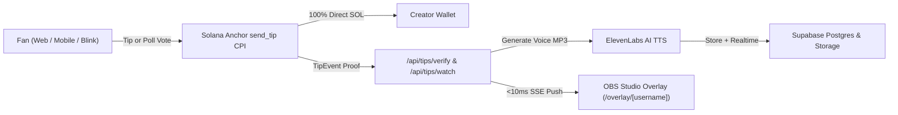

# SolStream ⚡

**Fan tips, wallet to wallet—the AI-voiced alert appears on OBS in about 1 second.**  
*Non-custodial Web3 live-streaming monetization built on Solana Devnet for the DEV3PACK Solana Hackathon.*

[](https://solstream-six.vercel.app)
[](https://solscan.io/account/BN6Zt6ctB4B5dTs8myMrq6CUp5Lea7jMitG9bp8cGKuA?cluster=devnet)
[](./LICENSE)

- **Live App:** [https://solstream-six.vercel.app](https://solstream-six.vercel.app)
- **Live Health Check:** [https://solstream-six.vercel.app/api/health](https://solstream-six.vercel.app/api/health)
- **Devnet Program ID:** [`BN6Zt6ctB4B5dTs8myMrq6CUp5Lea7jMitG9bp8cGKuA`](https://solscan.io/account/BN6Zt6ctB4B5dTs8myMrq6CUp5Lea7jMitG9bp8cGKuA?cluster=devnet)

---

## ⚡ How It Works

**Fan** → **Tip Page, Solana Blink, or OBS QR** → **Solana `send_tip` Transaction (0% cut)** → **Verifier / Watcher** → **OBS Overlay with AI Voice**



---

## 🌍 Why Solana?

Traditional platforms (Twitch Bits, YouTube SuperChat) take **30%–50% cuts**, hold payouts for weeks, and require **PayPal or Stripe**—locking out creators across Ethiopia and much of the developing world. Solana removes all of those barriers with **sub-second finality**, **fraction-of-a-cent transaction fees** that make `0.001 SOL` micro-tips viable, and **permissionless wallet-to-wallet settlement** with zero middlemen.

---

## ✨ Headline Features

1. **Amharic & Multilingual Live Voice Alerts:** Smart-contract UTF-8 byte validation (`300 bytes`) lets fans tip and trigger live on-stream alerts in **Amharic (`መልካም ስራ! በርታ!`)**, English, and 32 ElevenLabs AI voice languages—with instant browser speech fallback.
2. **0% Platform Cut via Anchor CPI:** Every tip executes a direct `SystemProgram::transfer` CPI from fan wallet to creator wallet inside [`programs/solstream/src/lib.rs`](./programs/solstream/src/lib.rs). SolStream never holds user funds.
3. **Customizable OBS Studio Overlay (`/overlay/[username]`):** Transparent 1920×1080 Browser Source with spring-animated alert cards, synth chimes, live stream goal bar, live poll HUD, and Solana Pay QR—every widget is **draggable and proportionally resizable (`50%–180%`)** right inside the overlay.
4. **Solana Blinks & Mobile Scan-to-Tip QR:** Fans can tip or vote from any Solana Actions v2.2 client (`/actions.json`) or scan the live QR code straight off the stream with Phantom/Solflare mobile.
5. **Live Micro-Vote Polls & Firecrawl Bio Auto-Fill:** Creators sign an Ed25519 message in Creator Studio to run `Option A` vs `Option B` tip-powered polls, and can paste any Twitch/YouTube/Kick URL on `/claim` to auto-fill their handle and goal via Firecrawl.

---

## 🚀 Try It in 2 Minutes

1. **Open the live app:** [https://solstream-six.vercel.app](https://solstream-six.vercel.app)
2. **Watch the OBS overlay in a second tab:** [https://solstream-six.vercel.app/overlay/amayu?preview=1](https://solstream-six.vercel.app/overlay/amayu?preview=1)
3. **Connect Phantom (or Solflare) switched to Solana Devnet** on the tip page: [https://solstream-six.vercel.app/amayu](https://solstream-six.vercel.app/amayu)
4. **Tip `0.001 SOL`** (or pick any preset / Amharic chip) and approve the transaction.
5. **Watch the overlay tab:** The alert card, synth chime, AI voice alert, goal bar, and supporter counter update live in ~1 second.

*(Want to try Creator Studio? Click **Creator Studio** on the homepage, connect your Devnet wallet, and claim your own handle on `/claim`.)*

---

## 🔗 Deployed Solana Smart Contract (Devnet)

- **Program ID:** [`BN6Zt6ctB4B5dTs8myMrq6CUp5Lea7jMitG9bp8cGKuA`](https://solscan.io/account/BN6Zt6ctB4B5dTs8myMrq6CUp5Lea7jMitG9bp8cGKuA?cluster=devnet)
- **Contract Source:** [`programs/solstream/src/lib.rs`](./programs/solstream/src/lib.rs)
- **Anchor 0.30 IDL:** [`src/idl/solstream.json`](./src/idl/solstream.json)
- **Instructions:**
  - `initialize_creator(username, voice_id, goal_target, goal_title)` — Creates `CreatorAccount` (`["creator", authority]`) and locks unique handle in `HandleRegistry` (`["handle", username]`).
  - `register_existing_handle()` — Backfill helper locking legacy handles in `HandleRegistry`.
  - `send_tip(amount, tier, display_name, message)` — Enforces `>= 1_000_000` lamports (`0.001 SOL`), transfers directly to creator `authority`, updates on-chain stats, and emits `TipEvent`.
  - `update_goal(new_target, new_title)` & `update_voice(new_voice_id)` — Authority-only stream studio updates.

---

<details>
<summary><strong>📡 API Reference & Application Routes (13 Routes)</strong></summary>

| Route | Purpose |
| :--- | :--- |
| `/` | Landing page, interactive tip preview, handle claim bar, Creator Studio shortcut, and Live Solana Market Board (`/api/prices`). |
| `/claim` | On-chain handle registration, optional Firecrawl URL auto-fill, alert voice picker, and stream goal setup. |
| `/dashboard` | Creator Studio with OBS Browser Source URL, live SOL metrics, goal & voice controls, Live Micro-Vote Poll manager, QR modal, and realtime tip ledger. |
| `/[username]` | Public fan tipping page with 6 micro-tiers, live SOL/USD converter, Amharic preset chips, Live Poll voting, Blink share link, and Top Supporters leaderboard. |
| `/overlay/[username]` | Transparent OBS Browser Source overlay with draggable & resizable widgets (`50%–180%`), ElevenLabs AI voice + browser fallback, and FIFO alert queue. |
| `/actions.json` | Solana Actions v2.2 manifest mapping `/api/actions/**` and `/tip/*`. |
| `/api/actions/tip/[username]` | Blink `GET`/`POST` endpoint building serialized `send_tip` transactions with preset tiers, poll votes, and Solana Pay `ref` forwarding. |
| `/api/actions/tip/[username]/confirm` | Chained Action callback triggering OBS SSE and TTS on Blink settlement. |
| `/api/polls/[username]` | Ed25519 wallet-signature-authenticated Live Micro-Vote poll API (`GET`/`POST`) with replay-nonce protection. |
| `/api/tips/verify` | Fail-closed on-chain tip verifier, ElevenLabs TTS generator, Supabase writer, and instant OBS SSE broadcaster. |
| `/api/tips/watch` | Watches Solana Pay `reference` keys so mobile QR tips auto-verify and fire on OBS. |
| `/api/creators/import-profile` | Firecrawl-powered URL scraper with SSRF & private-IP/DNS validation for `/claim`. |
| `/api/tips/recover` | Secret-protected (`503` if unset, `401` if invalid) background signature recovery endpoint. |
| `/api/health` | Readiness probe returning `{ ok, db, rpc, timestamp }` via Postgres + Solana Devnet `getSlot`. |
| `/api/prices` | Server-cached live Solana ecosystem prices (CoinGecko primary, Binance fallback). |

</details>

---

## 🛠️ Tech Stack & Local Setup

- **Stack:** Solana Devnet · Anchor `0.30.1` (Rust) · Next.js `16.4.6` (App Router) · React `19` · TypeScript · Tailwind CSS · Supabase (PostgreSQL, Realtime, Storage) · ElevenLabs TTS · Firecrawl
- **Install & Run Locally:**
  ```bash
  npm install
  cp .env.example .env.local   # Add DATABASE_URL, DATABASE_SSL_CA, Supabase, ElevenLabs keys
  npm run dev
  ```
- **Verify & Test:**
  ```bash
  npm run typecheck   # tsc --noEmit
  npm run lint        # eslint . (0 warnings)
  npm run test:unit   # 20 offline unit & route tests (Mocha + Chai)
  npm run build       # next build --webpack
  ```
- **Database Migrations (`supabase/migrations/`):** Run `001_solstream_schema.sql`, `002_creator_polls.sql`, and `003_tips_creator_id_index.sql` in order.
- **Anchor Tests & Upgrade:** See [`HANDLE_REGISTRY_MIGRATION.md`](./HANDLE_REGISTRY_MIGRATION.md) and [`tests/solstream.ts`](./tests/solstream.ts) (`anchor build && anchor test`).

---

## 🗺️ Roadmap

- **Phase 1 (Current — Devnet):** 0% cut CPI tips, OBS draggable/resizable overlay, ElevenLabs Amharic/multilingual AI alerts, Solana Blinks, Solana Pay QR, and Live Micro-Vote Polls.
- **Phase 2 (Program Upgrade & Mainnet-Beta):** Upgrade Devnet program with `HandleRegistry` + `ReservedUsername` per [`HANDLE_REGISTRY_MIGRATION.md`](./HANDLE_REGISTRY_MIGRATION.md), audit, and launch on Solana Mainnet-Beta.
- **Phase 3 (Ecosystem & Mobile):** SPL token / USDC micro-tips, creator subscriber badges, and native Solana Mobile Seeker integration.

---

## 👥 Team & License

Built by **Amayu Kaba** ([@amayukf](https://github.com/amayukf)) for the **DEV3PACK Solana Hackathon**.  
Licensed under the [MIT License](./LICENSE).
